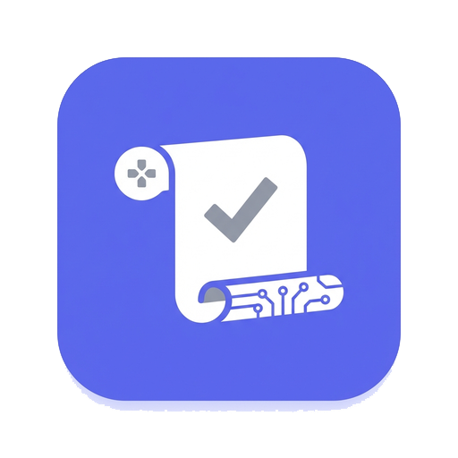
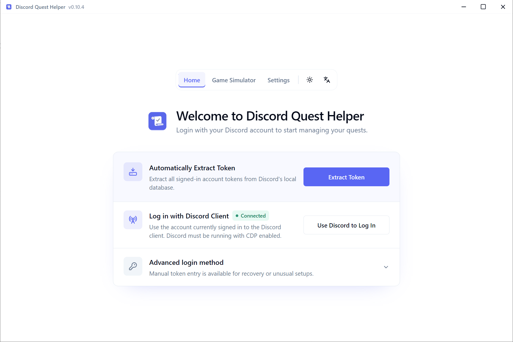
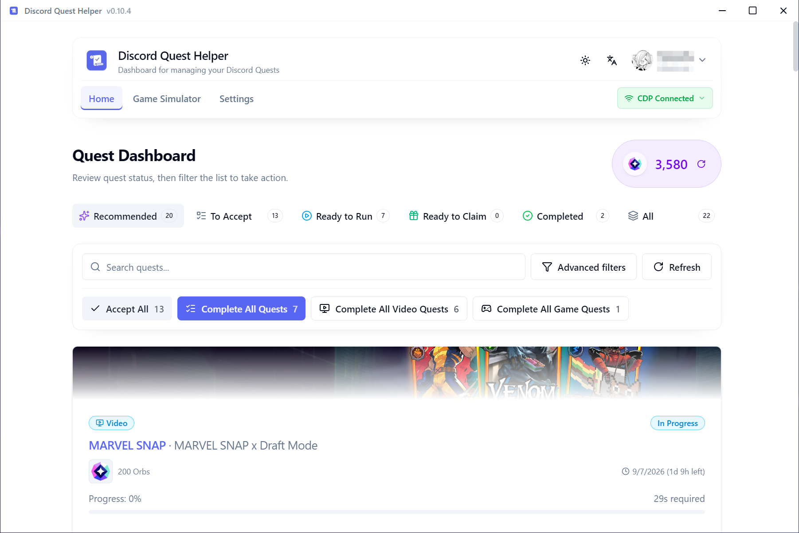
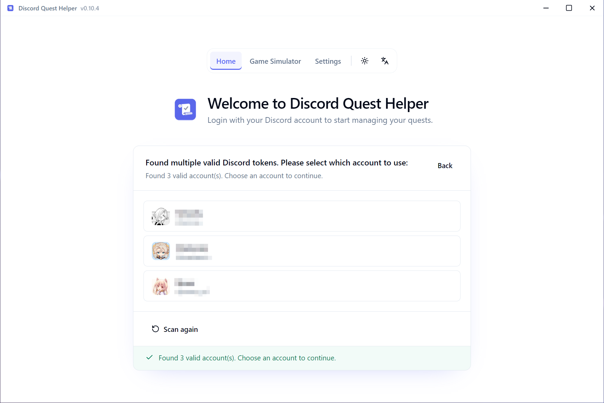

# Discord Quest Helper: Cross-Platform Automation for Windows 10 & 11

### 💻 PowerShell Installer

    

---

Discord Quest Helper is a cross-platform desktop application that automates the completion of Discord Quests, covering video, stream, game, and activity quest types from a single interface. Built on Tauri 2 with a Vue 3 frontend, it combines Discord API and Gateway integration with CDP-based client automation to drive quest progress reliably. The application supports flexible authentication through local profile detection, CDP login, or manual token entry, and includes a game simulator that completes game quests without requiring the underlying title to be installed. Multi-account management, advanced quest filtering, and multilingual support are provided natively across Windows, macOS, and Linux builds.

## ✅ Requirements

- **OS:** Windows 10 / 11
- **Shell:** PowerShell 5.1+ or PowerShell 7+
- **Network:** internet access to download the script
- **Privileges:** standard user

## Features

- **Unified Quest Coverage** — Handles video, stream, game, and activity quests through dedicated execution paths, with per-quest controls for starting, pausing, and monitoring progress.
- **Automatic Progress Tracking** — Quest state is polled and refreshed in real time, so completion status and reward eligibility stay current without manual reloads.
- **Zero-Download Game Simulation** — Game quests are satisfied by registering simulated game activity, eliminating the need to download, install, or launch the referenced title.
- **Video & Stream Automation** — Long-running media quests execute in the background while the interface remains responsive, with progress updates surfaced as they complete.
- **Activity Quest Execution** — Activity-based quests are driven through the same authenticated session pipeline, avoiding separate setup steps per quest type.
- **Flexible Authentication** — Supports automatic detection of supported local Discord profiles, CDP-based connection to a running desktop client, and manual credential entry as a fallback.
- **Client Selection** — Configurable desktop client target for CDP sessions, including custom installation paths when the default discovery does not match the local setup.
- **Multi-Account Management** — Multiple accounts can be added and switched within a single application instance, each with independent quest state.
- **Advanced Quest Filtering** — Filter available quests by reward type, completion status, and quest category to prioritize eligible tasks.
- **Cross-Platform Desktop Builds** — Ships as native packages for Windows, macOS, and Linux, including portable variants for environments without installer privileges.
- **Localized Interface** — Full internationalization across a broad set of languages, with locale-aware formatting for quest metadata and status labels.
- **Diagnostics & Logging** — Structured logs and debug views expose request state, session health, and execution errors, with sensitive values redacted from exported output.

## How it works

Discord Quest Helper is built as a Tauri 2 desktop application with a Vue 3 frontend and a Rust backend. The frontend never talks to Discord directly; every network operation, credential read, and automation session is owned by the Rust core and exposed to the UI through typed IPC commands.

**Session acquisition.** The helper resolves an authenticated session through one of three paths. Auto-detection scans supported local Discord profile directories and decrypts the stored token using platform-native protection — DPAPI on Windows, Keychain on macOS, and Secret Service on Linux. CDP login attaches to an already-running official Discord or Vesktop client through the Chrome DevTools Protocol and captures the session from the live renderer. Manual entry accepts a token directly when neither automated path is available. Tokens are held in memory only and are never intentionally written to disk.

**Quest discovery.** Once a session is established, the backend queries the Discord REST API for the account's available quests, including reward metadata, expiration, and per-quest task configuration. Results are normalized and pushed to the frontend, where they can be filtered by reward type, completion state, and task kind.

**Video and stream automation.** For video and stream quests, the helper drives a CDP-controlled session against the Discord web renderer. It loads the quest's target content, advances playback state as required by the quest definition, and holds the session open until the enrollment window and progress requirements are satisfied. Progress is polled from the API in the background so the UI reflects completion without blocking on the automation loop.

**Game and activity simulation.** Game quests normally require the titled application to be running and detected by Discord. The helper's Game Simulator avoids that dependency: it registers a synthetic game process for the selected title, which Discord observes as a running game, and reports the activity duration the quest expects. Activity quests use the same underlying activity-reporting path. No download, installation, or launch of the real title is required. All simulator processes are tracked and terminated on session end or application exit.

**Identity synthesis.** Discord validates game and activity reports against an executable fingerprint. The helper synthesizes a valid fingerprint payload for the simulated title rather than forwarding an empty or placeholder value, which is what distinguishes a clean report from one that triggers a Quest Activity Notice.

**Process and lifecycle management.** Client discovery, CDP launch, and simulator process supervision are handled by dedicated workspace crates so that platform-specific behavior stays isolated from quest logic. The backend performs ordered cleanup of CDP targets, child processes, and simulated sessions on completion, cancellation, or shutdown, preventing orphaned processes across Windows, macOS, and Linux.

**Multi-account operation.** Accounts are modelled independently: each holds its own session, quest list, and automation state. The scheduler runs quest loops per account, so progress on one account does not serialize behind another, and switching accounts in the UI does not tear down running sessions.

## Compatibility

The application is distributed as a native desktop build for Windows, macOS, and Linux, with each platform receiving a dedicated installer and a portable alternative.

- **Windows** — x64 systems are supported through an MSI installer for standard installation and a portable ZIP archive that runs without system-level changes.
- **macOS** — Apple Silicon (arm64) builds are provided as a DMG package. Because the application is distributed outside the App Store, Gatekeeper quarantine attributes may need to be cleared before first launch.
- **Linux** — x86_64 systems are supported through a Debian package for package-managed installation and a portable AppImage for distribution-agnostic execution. Animated reward previews rely on GStreamer media plugins, which are bundled in current release packages; older AppImage builds may require the host system to provide a compatible audio sink.

Discord client integration is available for both the official Discord desktop client and Vesktop. The built-in CDP login path discovers supported installations and can be pointed at custom executable paths when the client is installed in a non-standard location. Local token detection covers the standard Discord, Canary, PTB, Equibop, Legcord, Vesktop, ArmCord, and WebCord profiles across all three operating systems, including supported Flatpak layouts on Linux. Portable installations and custom data directories fall outside automatic discovery and require CDP login or manual token entry instead.

Quest coverage spans every quest category the platform exposes: video and stream quests are driven through the automated progress pipeline, while game and activity quests are handled by the zero-download Game Simulator or by manual CDP game sessions. No title-specific game installation is required for simulated game quests.

Runtime requirements are limited to the platform's standard desktop environment. Windows and macOS builds run without additional system dependencies; Linux builds expect a conventional desktop session with the libraries provided by the Debian package or the AppImage runtime.

## 📸 Screenshot

## FAQ

**Which quest types are supported?**

discord-quest-helper handles the full range of Discord Quest categories: video quests, stream quests, game quests, and activity quests. Video and stream quests progress through in-app media automation, while game and activity quests are completed via the built-in simulator without downloading the referenced titles.

**How does the app authenticate without storing credentials?**

Authentication is memory-only. The application resolves a session through one of three paths — local profile detection, CDP handoff from a running client, or direct manual entry — and holds the resulting token in process memory for the duration of the session. Nothing is written back to disk by design, and diagnostic exports redact sensitive fields before output.

**Does game simulation require the actual game installed?**

No. The Game Simulator synthesizes the runtime signals Discord expects for game and activity quests, including the executable fingerprint payloads used for activity attestation. You select the target title from the quest list, create a simulated session, and run it; no store download, install, or launch of the real game is involved.

**Which Discord clients can be used as a CDP source?**

CDP login supports the official Discord desktop client and Vesktop, with configurable installation paths for non-default setups. Local token detection covers a broader set of supported profiles across Windows, Linux, and macOS. Portable installations and relocated data directories generally fall back to CDP or manual entry.

**How are multiple accounts handled concurrently?**

Each account is an isolated session with its own token, quest list, and execution state. The multi-account view lets you switch contexts and dispatch quest runs independently, so progress on one account does not block or interfere with another.

**What are the platform and packaging requirements?**

Builds are available for Windows (installer and portable), macOS (Apple Silicon), and Linux x86_64 (Debian package and AppImage). The stack is Tauri 2 with a Rust backend and a Vue 3 frontend, communicating over Tauri IPC. Linux packages are x86_64 only; macOS releases currently target Apple Silicon exclusively.

**Where are quest progress and settings persisted?**

Application preferences, language selection, and account metadata are retained locally so the app restores its state between launches. Discord tokens are the exception — they remain in memory and are never intentionally serialized to disk. Progress itself is authoritative on Discord's side and is reconciled on each quest refresh.

**What happens if a quest run is interrupted or stalls?**

The backend owns process supervision and cleanup for CDP sessions and simulator runs. Interrupted runs can be restarted from the quest view, and the runtime bridge releases associated processes on session teardown to avoid orphaned handles.

**Does the interface support localization?**

Yes. The UI ships with fifteen locales — English, Simplified Chinese, Traditional Chinese, Japanese, Korean, Russian, Spanish, German, French, Indonesian, Polish, Portuguese, Thai, Turkish, and Vietnamese — selectable in Settings and applied without a restart.

**Can quests be filtered or prioritized?**

The quest list supports filtering by reward type, completion status, and other attributes, allowing you to narrow the view to actionable, incomplete, or reward-specific entries before dispatching a run.

## Disclaimer

This application is provided for educational and research purposes only. It is not affiliated with, endorsed by, or sponsored by Discord Inc. or any of its subsidiaries. All trademarks, service marks, and product names referenced remain the property of their respective owners.

Automating quest completion may conflict with Discord's Terms of Service and could result in account-level enforcement, including warnings, temporary restrictions, or permanent termination. The maintainers make no representations regarding the acceptability of this software under any platform policy, and users assume full responsibility for determining whether their use complies with all applicable terms, agreements, and local laws.

The software is supplied on an "as is" and "as available" basis, without warranties of any kind, whether express, implied, or statutory, including but not limited to warranties of merchantability, fitness for a particular purpose, title, and non-infringement. No guarantee is made that quest detection, video and stream automation, game and activity simulation, multi-account handling, or session management will function correctly, continuously, or without interruption across future client or service updates.

By design, the application processes authentication material in memory and interacts with locally installed client profiles, CDP endpoints, and platform-native credential stores. Users are responsible for safeguarding their own credentials, for operating the software only on accounts and devices they are authorized to use, and for understanding the data-handling characteristics described elsewhere in this document. The maintainers do not intentionally persist tokens to disk, but cannot guarantee that third-party components, operating system facilities, or host configuration will not retain traces.

In no event shall the authors, contributors, or copyright holders be liable for any claim, damages, or other liability — whether in an action of contract, tort, or otherwise — arising from, out of, or in connection with the software or its use. This includes, without limitation, loss of account access, loss of rewards, loss of data, service interruptions, or any indirect, incidental, special, consequential, or punitive damages, even if advised of the possibility of such damages.

Use of this software constitutes acknowledgement that you have read, understood, and accepted this disclaimer in full. If you do not agree with any part of it, do not install, run, or otherwise use the application.

## License

This project is released under the MIT License. The license grants permission to use, copy, modify, merge, publish, distribute, sublicense, and sell copies of the software, subject to inclusion of the original copyright notice and permission notice in all copies or substantial portions of the software.

The software is provided "as is", without warranty of any kind, express or implied, including but not limited to the warranties of merchantability, fitness for a particular purpose, and noninfringement. In no event shall the authors or copyright holders be liable for any claim, damages, or other liability arising from, out of, or in connection with the software or its use.

Redistribution of modified builds is permitted under the same terms. The full license text is provided in the LICENSE file distributed with the source.